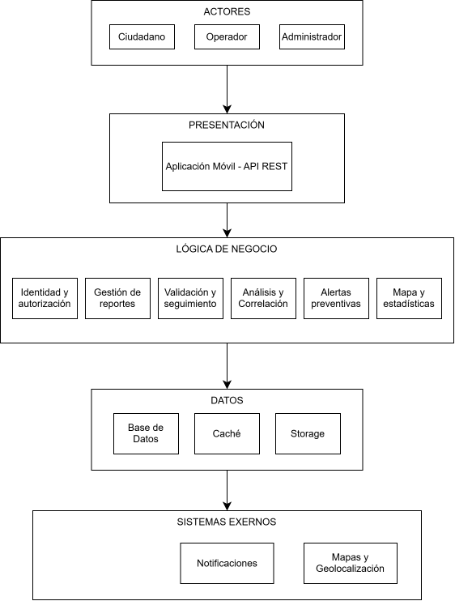

# Arquitectura inicial de AyniSafe

## Diagrama de Arquitectura

## Descripción

La arquitectura inicial de **AyniSafe** se organiza en tres capas principales:

- **Presentación:** permite la interacción de los ciudadanos mediante la aplicación móvil y de los operadores y administradores mediante el panel web. Ambas interfaces se comunican con el backend a través de una API REST.

- **Lógica de negocio:** contiene los principales módulos responsables de las funcionalidades del sistema: identidad y autorización, gestión de reportes, análisis y correlación, validación y seguimiento, alertas preventivas, mapas y estadísticas.

- **Datos:** permite almacenar y consultar la información de los usuarios e incidentes mediante PostgreSQL. El MVP utiliza un proveedor privado sustituible para las evidencias y no requiere Redis.

Asimismo, el sistema se integra con **servicios externos** de cartografía para la visualización de incidentes y servicios de notificaciones push para distribuir alertas preventivas a los ciudadanos.

La implementación del backend se propone como **monolito modular**, con separación interna de API/controladores, aplicación, dominio e infraestructura.

## Alcance actualizado

App Flutter/Dart (Android inicial, iPhone previsto); web React con portada pública y panel por rol; API modular compartida. Identidad administra instituciones, sedes y cobertura; Operaciones resuelve principal y apoyos según las 16 categorías; Alertas mantiene bandejas por usuario; Consultas ofrece polígonos, filtros, contactos y contenido. MVP sin Redis/SQS; proveedor de evidencias privado sustituible, Cloudinary candidato. Véase [alcance territorial e institucional](../01-analisis-del-sistema/09-alcance-territorial-e-institucional.md).

El diagrama inicial es un bosquejo histórico simplificado; no representa por sí solo el despliegue vigente ni todos los clientes. Las vistas C4 y ADR actuales delimitan el MVP y sus dependencias; las tablas de módulos incluyen el enrutamiento independiente y la evaluación rápida SAMU.